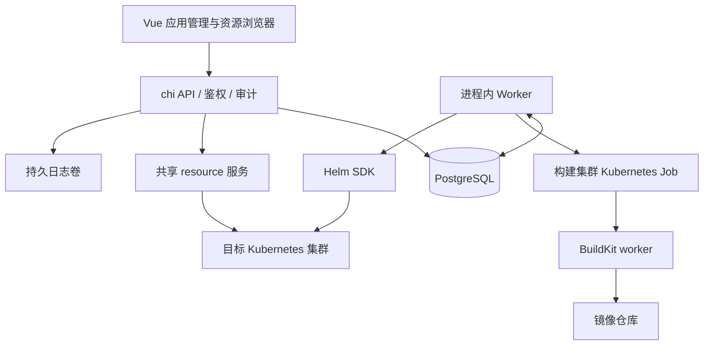

# 技术架构

## 1. 架构决策

采用 Go/chi 模块化单体，PostgreSQL + pgx + sqlc；Vue 3 + TypeScript 前端。沿用当前 Go 服务的 SPA 内嵌交付方式。第一版单实例部署，API 和 Worker 同进程；任务意图持久化，重启后恢复。不新增 Redis、外部消息队列、Operator 或强制对象存储。

CI 使用 Kubernetes Job + BuildKit。构建环境独立于应用发布目标，管理员配置构建集群和 Namespace。CD 使用 Helm SDK 和版本化内置 Chart。首版先验证 BuildKit worker、运行权限、存储和 Registry 连通性，再确定 rootless 及缓存配置，不预设用户集群已经具备这些能力。

## 2. 模块职责

```text
cmd/podry/          服务启动、管理员与账户 CLI
internal/auth/     身份、Token、权限动作和归属校验
internal/project/  团队、项目和成员关联
internal/application/ 应用、配置版本、环境绑定
internal/pipeline/ 流水线定义、Webhook、触发规则
internal/build/    构建、Job、产物和日志
internal/deployment/ 快照、Helm、状态观察、晋级、回滚
internal/cluster/  凭据、客户端池、连接状态和限流
internal/resource/ Discovery、列表、对象、关系、操作、日志、exec
internal/worker/   领取任务、并发与租约、恢复调度
internal/audit/    脱敏操作记录
internal/database/ migrations、queries、sqlc 生成代码
web/src/features/ applications、pipelines、resource-browser、settings
web/src/components/kubernetes/ 共享资源组件
```

每个业务模块按需组织 handler、dto、service、routes。service 不依赖 HTTP 请求对象。数据库 SQL 集中交由 sqlc 生成，避免无业务价值的逐层转发。生成代码不可手改。

## 3. 主要执行链



构建执行器和发布执行器通过具体接口隔离，首版仅实现上述一种；不预建没有实现的插件框架。构建上下文可以由 Job initContainer 固定 SHA 拉取到 emptyDir，构建容器使用明确 endpoint 的 BuildKit。凭据以任务级 Secret 临时挂载，结束确认后清理，不向用户命令注入管理员 kubeconfig。

构建检查脚本运行在无集群管理权限的容器，Job ServiceAccount、网络、资源和执行时间受限。平台对构建集群的控制凭据与用户代码进程隔离；Registry 推送凭据按仓库范围授权。

## 4. Kubernetes 访问

cluster 管理按集群和凭据版本建立客户端，credential 更新后失效旧客户端。Resource 使用 Discovery + RESTMapper + Dynamic Client；Pod、Node、Deployment 等常见 Kind 使用专用适配器生成展示字段。

请求先执行 Podry 授权，随后使用平台受限凭据访问 API Server。平台权限不是 Kubernetes RBAC 的替代；Kubernetes 拒绝时透传经过脱敏的明确原因。上传 kubeconfig 仅接受受支持的证书/Token 配置，服务端不执行来自上传内容的任意 exec 认证插件。

首版 List 按需分页，详情按需读取；Watch 只在活动页面/任务需要时建立，带重连与过期 resourceVersion 重列逻辑。不得把“缓存存在”当作“当前用户有权读取”。

## 5. Helm 发布与应用资源

Chart 以名称、版本、内容校验值标识，包归档到持久存储。一次发布固定配置版本、环境覆盖版本、Chart、镜像 digest 和敏感版本引用。Helm 状态与数据库 Deployment 分开观察，成功后记录 release revision、资源 UID 和应用当前发布指针。

普通发布使用平台应用模板，不开放任意 Helm hook。发布外部临时副作用、Chart CRD 安装等功能须单独设计。当前声明的回滚是基于历史快照重新发布，不直接把 Helm 历史 revision 当作唯一真实配置。

应用资源树先从记录的资源清单取根，再根据 UID/OwnerReference 查找子对象，Service selector 等关系作为有类型的辅助边。标签只用于索引；归属和权限不能依赖用户可改写的标签。

## 6. Worker 与幂等

短事务领取任务 → 保存外部操作标识 → 外部 I/O → 短事务校验版本并落结果。查询和后台任务均有并发上限；等待资源就绪期间不持有数据库行锁。unknown 状态执行核对，无法确认旧调用退出时保持物理目标占用。

详见 [流程与状态](../product/02-workflows-and-states.md)。禁止以“租约过期”“HTTP 超时”推断外部副作用不存在。Webhook、客户端重复请求、Job 创建重试和 Helm 发布恢复分别有独立幂等键。

## 7. 前端与流

沿用 `web/src/lib/request`，共享普通 HTTP 错误处理。NDJSON 日志采用单独认证 Fetch 流适配器，终端使用票据 WebSocket。页面卸载/目标切换必须主动关闭流，避免旧响应覆盖新页面。普通 HTTP 自动重试只适用于明确允许的读操作。

Monaco 与 xterm.js 在真实实现时按页面懒加载；离线原型无第三方运行时依赖。UI 空态、权限拒绝、连接失败、未知执行状态分别呈现。

V2 交互按用户 Devtron 实例重组：[页面合同](../prototype/01-page-spec.md)。ApplicationShell 下分 Configurations、Build & Deploy、两类 History；Resource Workspace 管理动态页签。应用内资源页签与集群内资源页签各自保留容器上下文，共用 Resource Detail、Manifest、Logs、Terminal。前端 Store 管理页签和草稿，后端模块/执行器不因 UI 容器改变而复制。

Select Material 需要 Git 服务的 branches/commits 只读投影；适配器只读取应用已配置仓库，并在触发构建时再次验证完整 SHA 与配置版本。这个新增设计合同已写入 OpenAPI，不意味着现有 chi 已实现该接口。

## 8. 部署与环境检查

基础部署：Podry 一个实例、PostgreSQL、持久日志和 Chart 卷；构建 Job 与目标应用在已授权集群运行。镜像仓库由管理员接入。主密钥通过部署 Secret 提供，备份时与数据库分开管理。

M1/M3 前先只读检查：Kubernetes 版本与可发现资源、Namespace/RBAC、Registry 可达性、镜像拉取/推送能力、BuildKit endpoint 与 worker、存储、日志持久化与网络规则。检查不足再补部署方案，不提前修改用户主机或集群。

多副本、独立 Worker、对象存储、GitOps 均为后续架构演进，不在首版声称支持。

## 9. 新应用引导与模板事务（V2.1）

Application Setup 是配置/流水线/绑定的只读投影，不新增一个可手动置为 true 的 configured 状态。新应用没有配置行，配置读取返回虚拟 version=0；Git/Build/Base 每次以 section 保存，在当前版本基础上合并并追加快照。Base 的 chart_config=null 表示尚未显式保存，不以默认 values 推断完成。

完整模板调用 `POST /apps/{appId}/workflow-templates`：短事务锁定应用工作流版本、核对配置版本和权限 → 检查单 CI 约束、环境策略、目标唯一性 → 创建 CI、Binding、CD 和正确上游 → 更新版本、写审计与幂等结果 → 提交。事务不访问 Git、Registry 或 Kubernetes，不触发任何执行。额外环境通过 add_deploy 在相同事务边界创建 Binding/CD。普通分步 Binding 不自动算完整部署流水线。

Git 提交查询是 Select Material 的独立只读 I/O；超时/无权限/分支不存在不生成 Build。运行时的 source initContainer 克隆失败才产生 failed Build。平台必须区分仓库地址已经保存、提交查询成功、CI 克隆成功这三层证据；不因首次成功就缓存为永久可达。网络失败可重试读取，不能自动重试产生副作用的请求。

Deployment 和应用 Job 使用两个版本化内置 Chart，底层仍由 Helm SDK 提交，共用 release target、快照与占用锁。Job 每次发布使用请求 ID 派生的确定性唯一名称，重放同一请求先读回 UID，避免重复任务；新请求使用新名称。Job PodTemplate 不做原地更新。观察器等待 Complete/Failed 或超时，而不是 Deployment Available/Ready。Job 不创建 Web 服务/HTTP 探针，保留执行身份供事件与 Pod 日志查询；归档成功后才按保留策略清理历史对象。成功 Job 与健康常驻服务在 UI 中分别显示 Completed 和 Healthy。

Worker 日志归档与执行结果独立落账。读取 Attempt 时派生 logAvailability，归档缺失或过期不抹掉成功状态和产物；实时日志断开不能直接判定任务失败。前端看不到日志时展示明确空态及原因，绝不填充模拟内容作为后端证据。
