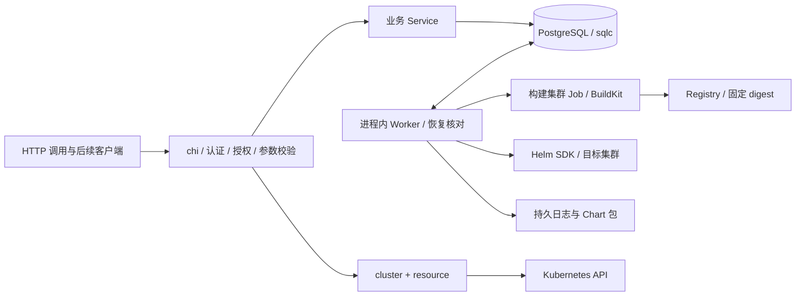
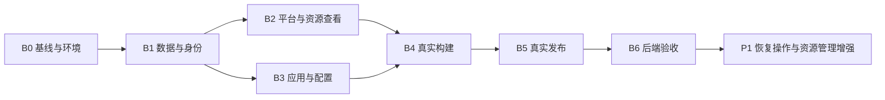

# 后端开发计划

版本：V1.8 · 日期：2026-11-21 · 状态：B1、B2 资源/日志、B3 管理配置及 B4 构建执行/恢复/产物/日志已实现；B5 增加离线预览、不可变快照、确认事务、持久 Helm Worker、目标占用及状态观察恢复。提前实现 T24 的进程 drain/统一停机时限并补充隔离 PostgreSQL 备份恢复演练，真实 CI/CD、生产恢复与外部清理尚未验收。构建/发布开关默认关闭。当前增量见 [进程启停与备份恢复](14-runtime-recovery.md)，前批见 [应用资源与健康观察](13-application-observation.md)、[发布执行与恢复](12-release-execution.md)、[发布规划](11-release-planning.md)、[构建执行](09-build-execution.md)、[Kubernetes 读取](08-kubernetes-resources.md) 与 [管理配置](06-control-plane.md)。

本计划定义完整后端路线；当前 61 个操作具备业务实现，15 个未注册，正式迁移版本 7。发布开关关闭时确认返回 503，开启后持久接收 202；真实远端 CI/CD 尚未验收。下文“当前基线”保留规划时的源码快照；应用资源、实时差异、查询时健康观察和 setup 发布候选见 [本批实施记录](13-application-observation.md)，后台持续健康轮询仍待开发。隔离数据库、模拟 API 和 SDK fake 的证据分别列在实施记录中，不能等同于真实发布验收。目标是提供可以独立调用、真实构建发布、可以重启恢复的 API 服务；验收使用 Go 测试与 HTTP 调用，不以页面或 Mock 作为完成条件。

阅读顺序：本文 → [开发任务清单](02-task-breakdown.md) → [HTTP 接口分期矩阵](03-api-delivery-matrix.md) → [Devtron 后端源码映射与取舍](04-devtron-source-mapping.md)。业务语义继续采用 [产品说明](../product/01-product-spec.md)、[流程与状态](../product/02-workflows-and-states.md)、[接口合同](../api/01-api-spec.md)、[数据模型](../data/01-data-model.md) 与 [技术架构](../architecture/01-architecture.md)。

## 1. 目标与当前基线

首批交付完成以下真实链路：

```text
管理员建账与授权
  → 接入已有 Kubernetes 集群、Namespace、Registry 和 BuildKit
  → 创建项目内应用，保存 Git / Build / Base
  → 原子创建一条 CI + 一个环境绑定 + 一条 CD
  → 选择固定提交，构建并推送 digest
  → 预览固定配置，确认发布
  → 查询部署结果、Job/Deployment、Pod、Manifest、Events、Logs
  → 查询操作审计
```

本次核对的 Git HEAD 为 `fd8d50b`；工作区另有未提交改动。以下结论来自当前源码读取，不代表已经构建或运行过后端。

| 项目 | 当前实际情况 | 开发起点 |
| --- | --- | --- |
| HTTP | `internal/server/router.go` 仅注册 `/healthz` 和静态/SPA 兜底 | 独立挂载 `/api`，未知 API 返回 JSON 404，避免回退到 HTML |
| 启动 | `cmd/podry/main.go` 加载配置、启动 HTTP、响应退出信号 | 加入依赖装配、数据库、Worker 启停与有界退出 |
| 数据库 | `go.mod` 尚无 pgx，仓库没有正式 migrations / queries / sqlc 配置 | 把 SQL 设计稿转为经过 PostgreSQL 验证的迁移 |
| 认证 | 配置中有 JWT / Refresh 字段，尚无认证实现 | 按合同使用 email 登录、Access Token、tokenVersion；暂不实现 Refresh |
| 配置 | `config.Load` 尚不读取数据库、主密钥和构建执行环境配置 | 增加实际必需字段及启动校验，保留已有注释 |
| 部署示例 | Compose 有 PostgreSQL，但 Podry 尚未接入；示例声明的管理员口令、`--version` 尚无对应代码 | B0 对齐示例与真实命令；不能据 Compose 推断已完成初始化 |
| 文档合同 | 76 个 HTTP 操作、31 张设计表 | 是设计输入，不能等同已实现接口和可执行迁移 |
| 参考实例 | Devtron 中已观察到源码构建、发布、Job/Pod 完成 | 仅提供业务依据；不证明 Podry 后端可用 |
| 参考后端源码 | 用户提供 `D:/workspace/devtron`，核对提交 `cebc4158bd9faa913b8d5071fa6425f61aa5c9ca`，检查时工作区干净 | 已核对 CI、CD、资源和发布恢复调用；未运行，不能等同于测试实例版本或可直接移植实现 |

本地源码核对确认：Devtron 有 Argo 与原生 Job 两种 CI 执行器，构建产物独立落库，Helm 发布路径经 Kubelink gRPC，资源工具部分位于 vendored common-lib。工作流容器保存不等于完整 CI/CD 模板事务；快照重试还会恢复当前部分凭据；发布恢复扫描也不能证明未知结果可安全重放。Podry 保留本计划的独立适配、版本化凭据和持久任务设计。函数、行号及 SC01–SC06 验收补充见 [源码对照](04-devtron-source-mapping.md)。

## 2. 分期范围

沿用当前 [轻量化方向](../migration/01-devtron-to-vue-plan.md) 的交付闭环。该文件本身规定前端迁移边界，本计划据后端实际依赖作以下补充：集群、凭据、环境、Registry 的最小管理接口必须提前；任务持久化、幂等、未知结果核对也必须随首个执行器交付。

| 领域 | P0：第一个可用后端 | P1：日常管理增强 | P2：后续评估 |
| --- | --- | --- | --- |
| 身份与归属 | CLI 建账；登录/退出；团队、项目、成员；应用和资源授权 | 更细角色配置与管理体验 | SSO、自助注册需另立合同 |
| 平台接入 | 管理员维护凭据、集群、Registry、环境、资源授权；显式连接测试 | 接入体验与轮换流程增强 | 自动发现、托管集群生命周期 |
| 应用与配置 | Git 来源应用；分节版本保存；派生 setup；完整 build_deploy 模板 | 镜像来源、克隆、其他模板、独立绑定管理、环境覆盖 | 应用分组、批量配置 |
| CI | 手动指定完整 SHA；受控 Dockerfile 构建；单架构；日志、digest、历史 | 用户取消/重试、Git Push Webhook、受限检查脚本 | 任意阶段、任意 DAG、插件 |
| CD | 手动发布；Deployment 与一次性 Job；一条真实环境链路 | 多环境交付、晋级、完整快照回滚、开发环境显式自动发布 | 灰度、蓝绿、审批、GitOps |
| 资源 | Discovery、Namespace、分页列表、对象、关系、Manifest、Events、Pod Logs | ConfigMap 与受控 YAML 更新、删除、重启、扩缩容、漂移 | 终端、Secret 明文、复杂集群运维 |
| 可靠性 | 持久意图、状态机、幂等、占用、自动核对、重启恢复、脱敏审计 | 用户发起的恢复操作与保留策略增强 | 多副本、独立 Worker、外部队列 |

P0 数据模型保留一 CI 多 CD 的可扩展结构，但只承诺一条目标环境的真实验收。P0 的环境覆盖为空、自动触发关闭；尚未交付的可选字段不能静默忽略，应返回明确校验错误。延后接口在实现前不注册，统一返回 JSON 404，不返回模拟成功。

已有 API 与 SQL 仍保留完整设计。接口是 P0/P1/P2 哪一期，以 [接口分期矩阵](03-api-delivery-matrix.md) 为执行顺序；字段和状态含义以现有合同为准。有差异时先修订合同，再写对应实现。

## 3. 架构与模块职责

采用 **Go + chi 模块化单体、PostgreSQL + pgx + sqlc、单实例 API 与 Worker 同进程**。持久任务存储在 PostgreSQL，内存通知只负责唤醒。CI 使用 Kubernetes Job 调用受控 BuildKit；CD 使用 Helm SDK 和版本化内置 Chart；日志与 Chart 包先使用持久卷。首版不要求 Redis、外部队列或对象存储。



下表路径和函数均为拟开发位置，不表示文件已经存在。模块内按需要组织 `routes.go`、`handler.go`、`dto.go`、`service.go`，不强制每个模块建立空转 Repository 层。

| 模块/位置 | 主要职责与建议入口 |
| --- | --- |
| `cmd/podry`、`internal/bootstrap` | 服务、迁移、管理员/用户命令；`RunServer`、`RunMigrations`、`CreateUser`；通过显式装配传递依赖 |
| `internal/server`、`internal/httpx` | API 注册、严格 JSON 解码、分页、错误映射、请求 ID；流式与普通请求分开设置超时和限流 |
| `internal/database` | `Open`、事务执行；`migrations/`、`queries/`、`sqlcdb/`；生成代码不手改 |
| `internal/auth`、`internal/project` | 密码与 Token、`RequireUser`、`AuthorizeApplication`、成员、项目归属与有效权限计算 |
| `internal/credential` | `CreateVersion`、`ResolveVersion`；凭据认证加密、作用域与历史版本，不向普通 DTO 返回明文 |
| `internal/cluster`、`internal/registry`、`internal/environment` | 连接配置；`ClientForCredentialVersion`、`TestConnection`、`ResolveDigest`；按目标限制权限与并发 |
| `internal/application` | 应用、配置、环境绑定；`SaveConfigSection`、`GetSetup`，归档检查与历史保留 |
| `internal/pipeline` | `CreateWorkflowFromTemplate`、`SaveWorkflow`；固定一 CI、多 CD；后续接 Webhook |
| `internal/git` | `ListBranches`、`ListCommits`、`ResolveCommit`；HTTPS 仓库、凭据引用、超时和固定提交校验 |
| `internal/build` | `TriggerBuild`、`PlanAttempt`、`EnsureJob`、`ObserveAttempt`、`FinalizeArtifact`；后续追加取消/重试 |
| `internal/deployment`、`internal/chart` | `CreatePreview`、`ConfirmRelease`、`EnsureRelease`、`ObserveDeployment`；Chart、快照、物理目标占用和资源身份 |
| `internal/resource` | `Discover`、`List`、`Get`、`Events`、`PodLogs`、`ListApplicationResources`；复用应用与集群查询逻辑 |
| `internal/worker` | `Claim`、`RenewLease`、`ReconcilePending`、`StopClaiming`；只按持久任务运行 |
| `internal/logstore`、`internal/audit` | `ArchiveAttempt`、授权日志读取、脱敏事件与查询；审计意图与业务事务一致 |

Service 接收业务上下文和已识别操作者，不依赖 `http.Request`。Kubernetes、Git、Registry、文件存储通过使用方定义的小接口接入，优先用于隔离外部 I/O 和故障测试，不建设插件框架。

## 4. B0 必须完成的合同补齐

这些是规划时源码/合同核对发现的实施项；实施过程中的 OpenAPI、SQL 与当前边界更新记录在 [管理与配置接口](06-control-plane.md) 和 [B1 实施记录](05-implementation.md)。

| 编号 | 当前缺口 | 实施决定/完成条件 |
| --- | --- | --- |
| C01 | JWT Refresh 配置、Compose 管理员初始化与实际代码不一致 | 账户 CLI-only、email 登录、无 Refresh；DB/主密钥/执行环境字段统一；迁移显式执行，不在每次启动重放初始化 |
| C02 | 外部 SDK 和执行环境未选定 | 记录实际 Go、PostgreSQL、目标 K8s、BuildKit/Helm 兼容矩阵；锁定依赖和工具镜像版本/摘要，不跟随 latest；确认 Git、runner、Helm 独立适配，不将 Devtron 的 Git Sensor/Kubelink 当成本项目已具备能力 |
| C03 | 构建仅固定配置版本，尚无完整运行参数冻结合同 | 为 Attempt 增加不可变 executionSpec/校验值，固定 Builder endpoint、runner/source 镜像、平台、资源、超时和凭据版本；恢复不得静默换成当前凭据；明确暂停 Job/依赖部分创建的核对步骤；补正式迁移与恢复测试 |
| C04 | Builder 的 digest 如何可信回传未定义 | 受控 runner 读取 BuildKit metadata-file，写入有版本的简短 termination message；Worker 读取明确容器状态，向 Registry 复核 digest；日志文本不作为产物事实 |
| C05 | Job 唯一命名与预览/最终渲染标识需要一致 | 预览时预留 deployment UUID，存入 preview 内部快照；确认时沿用该 UUID，Job 名由 releaseName + UUID 派生。预览不创建执行记录；同一预览重复确认不能生成第二个执行身份 |
| C06 | preview / snapshot 可能受绑定或管线更新影响 | 消费时重验操作者、有效期、配置版本、绑定版本、CD 定义版本和目标；冻结 Chart、digest、版本化 Secret；补缺失字段或摘要，不在 Worker 读取最新草稿 |
| C07 | 凭据 DTO 的 payload 仍是宽泛 object | 按 git/registry/kubeconfig/secret 定义输入校验和权限；拒绝 kubeconfig exec/auth-provider 等未支持认证扩展；确定加密格式、keyId、版本保留与轮换 |
| C08 | 后台状态、失败原因与日志阶段的展示字段不足 | 对照实际状态机补请求/执行错误码、阶段与时间投影；区分失败、unknown、日志不可用；明确 Discovery 部分失败的降级/错误合同，不能伪装成空集群；不由 handler 拼接合成结果 |
| C09 | 归档时在途任务、模板并发、停用用户后的执行规则需固定 | 归档前拒绝仍有活动/unknown 任务的应用；已接收任务以已冻结意图推进，领取/外部写入前重验执行授权，未知外部结果优先核对；不用撤权掩盖已有写入 |
| C10 | 权限矩阵与资源范围未具体落地 | 明确团队成员、项目成员及资源 grant 的组合规则；默认无权，不能通过加入其他项目、修改 ID 或标签越权；补双团队、双 Namespace 用例 |

C04 的消息仅承载小型结构化结果，建议控制在 1 KiB 内，并检测截断、无结果及版本不兼容；消息缺失时不能宣布构建成功。它是本项目的实现选择，需要 B4 实测。Kubernetes 的 termination message 有大小上限，见文末官方资料。

## 5. 实施阶段与完成门槛

阶段编号 B0–B6 为 P0 后端计划，与旧 [M0–M5 全量路线](../delivery/01-plan-and-acceptance.md) 独立；旧 M2 中的资源写入不再先于 CI/CD。每一阶段必须同时交付接口、持久化、权限、错误语义和验证证据。

| 阶段 | 交付内容 | 前置 | 完成门槛 | 初步投入 |
| --- | --- | --- | --- | --- |
| B0 基线与环境 | C01–C10 决策、API 分期、外部环境实测清单、依赖锁定方案 | 无 | 每个不确定项有选定方案或明确阻塞；外部环境责任人确定 | 2–3 人日 |
| B1 基础与归属 | 正式迁移、sqlc、CLI 建账、登录/退出、团队/项目/成员、授权、审计、幂等工具 | B0 | 真实 PostgreSQL 迁移/约束/事务通过；CLI 建账号后可登录；越权拒绝 | 6–8 人日 |
| B2 平台与资源读 | 加密凭据、集群/Registry/环境管理、grant、Discovery/List/Get/Events/Pod Logs | B1 | 两个集群或明确隔离上下文读实测；目标与 UID 一致；断流与授权撤销可收敛 | 6–9 人日 |
| B3 应用与配置 | 应用 CRUD、分节版本、setup、完整工作流原子创建、模板幂等 | B1；集群目标校验需 B2 | 新应用无配置/CI/CD；版本冲突明确；失败不留下半个工作流 | 5–7 人日 |
| B4 真实 CI | Git 查询、固定 SHA、Job + BuildKit、digest、历史、实时/归档日志、恢复 | B2 + B3 | hello-world 真实构建并推送，可按 digest 拉取；创建响应丢失/重启不重复建有效 Job | 10–14 人日 |
| B5 真实 CD | 预览/确认、冻结快照、占用、Helm、Deployment/Job 观察、应用资源与历史 | B4 | 同一产物发布成功；Job 完成与常驻服务就绪分别验证；unknown 不重复提交 | 9–13 人日 |
| B6 后端验收 | 无页面端到端、故障注入、恢复、权限、日志保留、部署/恢复说明 | B2–B5 | 第 8 节 P0 必测全部有真实证据；范围与未支持能力明确 | 5–8 人日 |

初步合计 **43–62 人日**，是工作拆分估算，尚未经过环境验证。预留 20%–30% 集成余量约 **52–81 人日**。假设 2 名熟悉 Go/K8s 的后端工程师，另有运维协助和测试资源，日历窗口约 **6–9 周**；单人不应直接套用双人窗口。B0 后按环境和技术验证重估，不在本计划虚构开始/结束日期。

B1 完成后，B2 与 B3 可分工推进；B4/B5 的状态、快照和恢复职责应保持连续负责人。任务级拆分和对应完成条件见 [开发任务清单](02-task-breakdown.md)。



## 6. 核心事务与执行流程

### 6.1 配置、模板与构建

保存配置时锁定应用并校验 expectedVersion，仅合并当前节，再追加版本。新应用返回虚拟版本 0；workloadKind 第一次保存后锁定。保存仓库地址不代表 Git 当前可达。

完整模板在同一短事务检查配置与工作流版本、目标授权和唯一性，写入 CI、Binding、CD、幂等结果及审计意图。事务不访问远程 Git/Kubernetes，也不触发构建。单独创建 Binding 不计算为完整 CD。

构建触发按以下顺序实现：

1. 验证应用、流水线、版本、完整 SHA、凭据引用与权限；Git 查询失败不产生 Build。网络校验在事务外完成，落账前再次检查配置版本。
2. 短事务保存 Build、Attempt、确定性 Job 名、executionSpec、幂等结果和审计意图，返回 202。
3. Worker 领取 Attempt，先查询同名 Job 的身份，再决定创建；身份冲突不覆盖。Job 的 `backoffLimit=0`、Pod `restartPolicy=Never`，避免隐藏重试绕开 Attempt 历史。
4. initContainer 拉取并校验固定 SHA；受控 runner 调用 BuildKit。P0 不执行任意 checkScript。任务容器不挂载平台集群管理凭据，不默认挂载宿主 containerd/Docker socket。
5. Job 成功后读取结构化结果并向 Registry 验证 digest；同事务保存 Artifact 与成功状态。日志归档状态独立更新，不把缺日志变成构建失败。

源码拉取、Builder 和目标平台先在实际环境验证。初始只要求一个实际支持的平台，不自动启用 QEMU、多架构或跨平台缓存。BuildKit 接入模式和工作区以 B0 记录为准。

### 6.2 发布预览与确认

预览冻结应用、Artifact、配置、绑定、CD 定义、Chart 与 Secret 版本，计算脱敏 Diff 和摘要，保存操作者与有效期。渲染与外部读取不放在长事务中；保存前再验证读取版本未变化。

确认接口消费 previewId：同事务重验权限和版本，保存不可变 ReleaseSnapshot、ReleaseRequest、预留身份对应的 Deployment、幂等结果与审计意图。该事务只创建 `queued` 执行记录，不表示已占用或已向 Helm 提交；返回合同中的 ReleaseRequest，不混用两个 ID。

Worker 按 `(clusterId, namespace, releaseName)` 领取物理目标占用，记录 fencingToken 后提交事务，再调用 Helm。执行只读取冻结快照。Helm 返回成功后仍需观察 Deployment 的 generation/就绪条件，或 Job 的 Complete/Failed 条件；不能以 Helm 接受请求或 Pod Running 作为统一成功条件。

每次 Job 发布使用预留执行 ID 对应的新名称；同请求重放沿用名称和 UID，不新建第二个业务任务。Chart 在 P0 只允许受控 Deployment/Job 模板，无任意 hook 和第三方 Chart 执行。

### 6.3 未知结果与重启

任务领取使用 PostgreSQL 短事务，外部 I/O 期间不持有数据库行锁。`FOR UPDATE SKIP LOCKED` 只用于队列领取，不用于普通业务读取。

| 场景 | 必须行为 |
| --- | --- |
| Job 创建超时 | 按确定名称、UID、任务身份核对；明确不存在且无仍在途旧创建后才允许补建 |
| Registry 复核失败 | 不返回可发布产物；区分构建执行结果与产物核验问题，保持可核对状态 |
| Helm 超时或进程退出 | 保持 unknown 和目标占用；核对 release 的本次执行标识、revision 和资源，不直接重复 install/upgrade |
| Worker lease 过期 | 允许接手观察；不能据此判断旧外部调用未发生，也不能清空物理占用 |
| Podry 重启 | 从 PostgreSQL 扫描非终态和 unknown，先核对再推进；不依赖进程内队列恢复 |
| 用户权限变化 | 新操作拒绝；活动流定期重验后关闭；已提交外部写入继续核对事实，不能伪造取消 |
| 无法确认旧调用已退出 | 暂停新提交，提供只读诊断和人工处理说明；禁止直接改终态/清锁作为恢复方式 |

数据库 fencingToken 仅阻止过期 Worker 回写数据库。Helm 不受数据库令牌约束，不能用它宣称远端操作具备 exactly-once 保证。

### 6.4 资源查询与日志

资源按 Discovery 返回的 GVR、作用域与 verbs 请求；授权在查询前实施，不先读全量再过滤。分页保留 continueToken 和 resourceVersion；全 Namespace 查询只能覆盖实际授权范围。内置重点为 Deployment/Job/Pod，其他已授权 GVR 提供通用只读投影；不为每个 Kind 开发专属管理器。

应用资源从已记录根资源身份和 UID/OwnerReference 遍历，不能仅按可改标签认定归属。应用授权与目标资源授权取交集；内外两个入口调用同一个资源服务。

资源身份在提交/观察阶段持续记录，在途或失败发布也须能够读取其关联 Pod、事件和日志，不能等到成功才记录清单。当前成功发布与在途/失败执行的资源分别标明来源；仅成功发布更新绑定的 currentDeploymentId。

Manifest 和所有日志响应先做敏感边界处理：Secret 默认仅元信息/键名，不返回 `data`、`stringData` 或可能夹带原文的 last-applied annotation。凭据、解密后的配置、请求密码和临时票据不进入审计与普通日志。

NDJSON 日志使用独立流处理、并发/时长/字节限制和取消上下文，支持容器、tail、previous、follow。实时日志与持久归档的游标、可用性分别定义；P0 具备实时读取和结束后持久卷归档，并允许归档失败时明确返回 unavailable。流断开不推导业务失败。

## 7. 数据库与依赖实施方式

将 [31 表设计稿](../data/schema.sql) 按依赖拆分为版本迁移：身份归属与审计 → 平台凭据授权 → 应用配置与流水线 → 构建产物 → 发布快照与执行。预览/资源写入/Webhook/exec 所需表按对应阶段加入，P2 表不因设计稿存在就提前开发业务。

双向外键如 Target ↔ Deployment、Binding.currentDeploymentId 在被引用表建立后追加。迁移需验证空库安装、已有版本升级、约束拒绝非法数据、可回退阶段的回退与重新升级；已含业务数据的发布升级优先前滚修复，备份恢复单独演练。

采用 pgx/v5 与 sqlc 的 pgx 输出；事务使用生成的 `WithTx`。迁移工具拟采用 golang-migrate，B0 锁定兼容版本。sqlc 查询围绕业务用例和短事务编写，不在 handler 内拼 SQL。

服务运行角色与迁移角色分开。不可变配置、执行规格、发布快照通过服务规则和数据库权限/约束共同保护；SQL 设计稿目前没有完整实现这些保护，不能直接原样宣称生产可用。

## 8. 不依赖前端的验收

| 编号 | 必测场景 | 必须留存的证据 |
| --- | --- | --- |
| BE-AC01 | 显式迁移、CLI 建账、重复初始化、email 登录/退出、停用 | PostgreSQL 结果、HTTP 状态与 Token 失效；无默认密码 |
| BE-AC02 | 双团队/项目、跨应用 ID、未授权集群/Namespace/日志 | 拒绝响应，无敏感对象泄露；grant 变更生效 |
| BE-AC03 | 分节保存、并发版本冲突、原子模板失败/幂等重放 | 配置历史完整，无半个 CI/Binding/CD |
| BE-AC04 | Git 不可达、认证失败、无分支、无提交 | 明确错误且 Build 数量不变 |
| BE-AC05 | hello-world 构建、路径越界、克隆失败、Builder/Registry 失败 | Job/Pod UID、固定 SHA、metadata 与 Registry digest；无伪产物 |
| BE-AC06 | Job 创建响应丢失、Build Worker 重启、归档失败 | 同 Attempt 无重复有效 Job；日志问题不抹去产物 |
| BE-AC07 | 预览过期、配置/绑定/CD 变化、他人消费、重复确认 | 409/410 或权限拒绝；同键同结果；同 preview 无第二次发布 |
| BE-AC08 | 同物理目标并发、Helm 超时、发布中重启 | 一次有效外部提交，unknown 保留占用，恢复有核对记录 |
| BE-AC09 | Deployment 与 hello-world Job 发布 | Deployment generation/就绪；Job Complete 与成功 Pod；实际镜像 digest 一致 |
| BE-AC10 | 资源分页、UID 替换、事件、Pod 日志中断与权限撤销 | 目标不串用，明确空态/错误，流可关闭 |
| BE-AC11 | 日志/Chart 持久卷和密钥/数据库恢复 | 已知快照仍可解析；归档校验；数据库恢复不自动重发未知任务 |
| BE-AC12 | 审计与业务结果对应、错误数据脱敏、未知 API | requestId、操作者、目标、执行结果可追溯；API 404 为 JSON |

测试分层：状态/授权/合并规则单元测试；真实 PostgreSQL 事务与并发测试；Kubernetes/Registry/BuildKit/Helm 真实集成；最后用 HTTP 脚本完成完整链路。fake client 只能覆盖本地逻辑，不能替代 CRD/Admission/RBAC/Watch 的真实集群证据。

开发时执行适用的 `go test ./...`、`go vet ./...`、定向竞态检查、sqlc 生成差异与正式迁移测试。B1 为 API 测试注入临时 `fs.FS`，业务包可定向测试，无需页面开发。`embed.go` 仍在编译期依赖 `web/dist`；因此当前结构下，完整 `go test ./...`、`go vet ./...` 和二进制构建也需要已有静态产物。验证记录须明确这个前置条件，不把注入测试文件系统误写为已解除整个模块的 embed 依赖。

每个阶段提交验证记录：代码 revision、依赖与环境版本、调用脚本、任务/资源身份、成功与故障结果、未通过项。不要记录真实密码、kubeconfig 或认证头。规划阶段仅做文档检查；当前已执行的 PostgreSQL/HTTP 测试见 [管理与配置接口](06-control-plane.md)，没有修改真实集群。

## 9. P1 的拆分与发布条件

| 批次 | 范围 | 依赖和验收重点 |
| --- | --- | --- |
| P1-A 交付增强 | 取消/重试、Webhook、额外 CD 与环境覆盖、现有镜像导入、晋级/回滚 | 依赖 B6；保留同一执行器和快照；固定 SHA/digest，取消与完成竞态、Delivery 去重、历史 Secret/Chart 可用性 |
| P1-B 资源管理 | ConfigMap、Dry Run/Diff、逐对象创建/更新、UID 删除、Deployment 重启/扩缩容、漂移 | 依赖 B2/B5 的授权和资源身份；多文档 partial；旧 UID/版本拒绝；HPA 与平台发布冲突处理 |
| P2 专项 | Secret reveal、终端、复杂发布、指标及平台扩展 | 单独明确协议、权限和运行资源；不占用 P0 阻塞路径 |

用户此前要求的“K8s 查看管理”在完整路线中保留：P0 提供查看与应用发布，P1-B 才交付通用资源写操作。不得把 P0 验收称为完整资源管理产品。

P0 完成后应先用现有环境验证使用频率，再确定 P1-A/P1-B 的先后和投入。本计划没有授权现在修改后端、安装依赖或向集群执行任务。

## 10. 外部环境、风险与下一步

B0 先只读核对：实际数据库/Go 工具链、Kubernetes 版本和授权 Namespace、BuildKit endpoint/worker/平台、Git 出网与私仓认证、Registry CA 和推送/拉取权限、持久卷读写与保留。随后在明确的测试 Namespace 内完成最小构建/发布验证；环境缺项先列出修复方案，不能假定宿主 socket、QEMU、默认 Namespace 或历史测试实例可直接复用。

最容易影响交付的是 Git/镜像网络、Builder 权限与平台、Helm 未知结果恢复、Job 唯一身份和敏感版本留存。B4/B5 的估算应以这些技术验证结果调整，而非按接口数量机械分摊。

开始实施时的第一批任务是 T00–T04：确认合同/兼容性、验证环境、建立 API 与数据库装配和迁移。先形成“建账 → 登录 → 建项目”的可调用后端，再推进资源、构建和发布。

以下官方资料于 2026-11-20 核对；实施版本仍需按 B0 兼容矩阵锁定：

- [sqlc：使用 pgx](https://docs.sqlc.dev/en/stable/guides/using-go-and-pgx.html) 与 [事务](https://docs.sqlc.dev/en/stable/howto/transactions.html)：生成查询与事务绑定。
- [PostgreSQL 16 SELECT](https://www.postgresql.org/docs/16/sql-select.html)：队列领取用 SKIP LOCKED 的适用边界。
- [BuildKit 官方仓库](https://github.com/moby/buildkit)：buildctl、镜像输出与 metadata-file。
- [Kubernetes Job](https://kubernetes.io/docs/concepts/workloads/controllers/job/)：成功/失败、期限与重试行为。
- [Kubernetes termination message](https://kubernetes.io/docs/tasks/debug/debug-application/determine-reason-pod-failure/)：结构化小结果回传的机制和大小限制。
- [Kubernetes API Concepts](https://kubernetes.io/docs/reference/using-api/api-concepts/)：分页、版本、Dry Run 与逐对象 API 语义。
- [Helm Go SDK](https://helm.sh/docs/sdk/examples/)：使用 SDK 的 action 配置与示例；不是对远端幂等或事务的保证。
