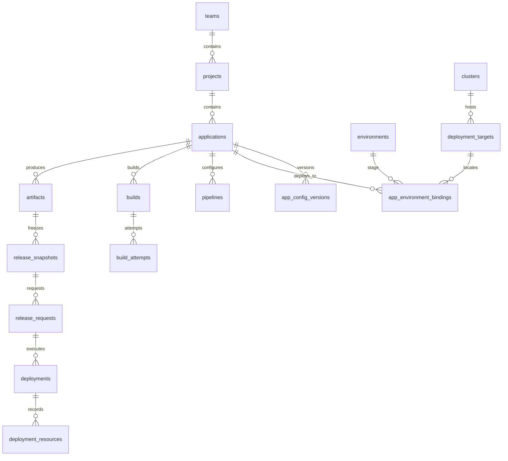

# 数据结构设计

SQL 设计稿：[schema.sql](schema.sql)。API DTO 为 camelCase，数据库列为 snake_case。设计稿用于评审，尚未作为迁移运行，不能据此认定外键、并发控制或恢复已经通过 PostgreSQL 验证。

## 1. 实体关系



## 2. 表目录与主要字段

| 表 | 主要字段 | 关键约束 |
| --- | --- | --- |
| users | id, email, name, password_hash, token_version, disabled_at | email 唯一，密码哈希不出 API |
| teams | id, name | 团队名称唯一 |
| team_members | team_id, user_id, role | 联合主键 |
| projects | id, team_id, name | 同团队内名称唯一 |
| project_members | project_id, user_id, role | 项目授权，仍校验所属团队成员 |
| credentials | id, team_id, kind, encrypted_payload, version | 平台或团队作用域，kind 固定集合 |
| clusters | id, name, api_server, credential_id, connection_status | 引用 kubeconfig 类型凭据由服务校验 |
| environments | id, name, production, auto_deploy_allowed | 全局逻辑环境名唯一；production 不可自动发布 |
| registries | id, name, endpoint, credential_id | Registry 凭据仅引用 |
| resource_grants | user_id/team_id/project_id, cluster_id, namespace, resources, actions | 三种 principal 恰好一个；操作仍逐对象检查 |
| applications | id, project_id, name, source_mode, workflow_version, archived_at | 同项目内名称唯一，工作流版本做乐观锁 |
| app_config_versions | app_id, version, git_config, build_config, chart_config, deploy_values, secret_refs | 同应用版本唯一、不可变；JSON 不含凭据明文；chart_config=null 表示 Base 未确认 |
| deployment_targets | cluster_id, namespace, release_name, active_deployment_id, fencing_token | 物理目标唯一，未知结果保留占用 |
| app_environment_bindings | app_id, environment_id, target_id, override_values, version, auto_deploy, detached_at | v20：每应用每环境只允许一个活跃绑定；解绑保留历史，物理目标仍独占 |
| pipelines | app_id, binding_id, kind, definition, version, enabled | 每应用一条 CI，每绑定一条 CD |
| builds | app_id, pipeline_id, config_version, commit_sha, status, attempt_no | 固定输入，状态是当前 attempt 投影 |
| build_attempts | build_id, attempt_no, job_name, job_uid, status, lease_*, cancel_requested_at/by, next_cleanup_at, cleanup_attempts, cleanup_error_code, resources_cleaned_at | attempt 唯一，任务名唯一，租约独立于外部状态；取消意图不可变；v19 清理不删除执行历史 |
| artifacts | app_id, build_id, attempt_id, image_repository, digest, source, registry_id, registry_credential_id/version, imported_by | build 固定 Build/Attempt；external 无构建，冻结 Registry/准确凭据/导入者；digest 格式及不可变约束 |
| secret_versions | credential_id, version, encrypted_payload | 只允许显式保留的历史密文版本 |
| deployment_previews | app_id, binding_id, config_version, snapshot, expires_at | 短期预览，消费时校验版本与授权 |
| release_snapshots | app_id, binding_id, artifact_id, config_version, chart_*, values_redacted, secret_refs, manifest_redacted | 不可变、不得保存敏感明文 |
| release_requests | snapshot_id, kind, source_deployment_id, reason, status, requested_by | deploy/promote/rollback/offline；由快照确定目标；回滚/下线理由 1–1000 字，来源与身份不可变 |
| deployments | request_id, target_id, status, helm_revision, lease_*, fencing_token, next_cleanup_at, cleanup_attempts, cleanup_error_code, resources_cleaned_at | 每请求一个执行记录；外部状态与请求状态区分；v19 只回收被替代且无人引用的执行资源 |
| deployment_resources | deployment_id, group_name, version, resource, kind, namespace, name, uid, manifest_hash | 保存资源身份，UID 不是名称别名 |
| resource_previews | cluster_id, requested_by, encrypted_documents, key_id, items_redacted, expires_at, consumed_at | v12；身份与密文不可变，10 分钟有效且仅消费一次；重验授权/凭据/UID/RV |
| resource_operations | preview_id, cluster_id, requested_by, kind, status, encrypted_payload, payload_redacted, result_redacted, stop_on_error, lease_owner, lease_expires_at, revision, retry_at | v13 支持 apply/delete/restart/scale；仅 apply 必须有唯一且同集群/用户的 preview，动作无 preview；lease/revision CAS，unknown 只读核对 |
| application_drift_observations | binding_id, deployment_id, snapshot_key, status, reason, resource_count, changed_count, missing_count, observed_at | v14；只存身份摘要/数量，不存资源值或值摘要；60 秒缓存、每绑定保留 100 条，当前成功基线最近 20 条查询 |
| pipeline_push_authorizations | pipeline_id, authorized_by, pipeline_version, repository_url | v15；工作流保存显式委托用户，投递时重验权限和版本 |
| pipeline_deploy_authorizations | pipeline_id, authorized_by, pipeline_version | v16；保存者显式委托 deploy，当前权限持续重验 |
| binding_health_polls | binding_id, next_poll_at, lease_token, lease_until, started_at, last_error_code | v17；每绑定一行、45 秒 lease 与 token fencing、30 秒重试；只存可重建调度元数据 |
| auto_deploy_intents | build_id, pipeline_id, binding_id, authorized_by, config/workflow/CI/CD/binding versions, status, request_id, next_poll_at | v16；构建准入同事务捕获，不追历史；每 Build/CD 唯一；身份/终态不可变、历史不可删；恢复重验策略 |
| webhook_deliveries | provider, pipeline_id, delivery_id, request_hash, build_id, status | 唯一 provider+pipeline+deliveryId；v18 支持 github/gitea/gitlab/gitee，仍为 36 表 |
| idempotency_records | user_id, operation_id, key, request_hash, response_status, response_body, expires_at | 相同键不同 hash 拒绝 |
| exec_sessions | user_id, cluster_id, pod_uid, ticket_hash, expires_at, closed_at | 只存 ticket hash，不存输入内容 |
| audit_events | actor_id, action, target, request_id, result, diff_redacted | 追加写入，按归属过滤读取 |
| log_archives | build_attempt_id, deployment_id, storage_key, byte_size, sha256, expires_at | 恰好关联一种任务，不存任意客户端路径 |

`resource_grants` 是首版显式授权模型；`namespace='*'` 必须管理员授予，`namespace=''` 表示集群级资源，不将二者混为一谈。actions/resources 数组采用服务端白名单，不能由普通用户自行扩大。

`applications.workflow_version` 表示整个 CI/CD 定义集合版本，与单条 pipeline.version 分开；保存工作流时在同一事务更新集合版本与条目。资源预览的原始 YAML 可能包含 Secret，必须加密保存，API 只返回脱敏 Diff。

### V2.1：新应用、模板和配置进度

- 应用刚创建时没有 config、pipeline、binding、artifact、deployment_resource 行。GET config 的虚拟版本 0 不是数据库实体。
- 保存单节时，以 expectedVersion 锁定快照并合并 git/build/base；仅新版本写入，不能修改旧快照。git_config 非空表示已保存 Git，build_config 非空表示已保存构建，chart_config 非空表示已显式确认 Base。初始 deploy_values={} 不表示 Base 完成。
- chart_config 为 `{workloadKind:"Deployment"|"Job",chartVersion:"1.0.0"}`；workloadKind 跨版本保持第一次非空值，服务事务校验，SQL 行 CHECK 本身不能实现跨版本锁定。Chart 来源、摘要、存储位置在发布快照中进一步冻结。
- 进度、configured、canBuild、canDeploy 和日志可用性都是派生视图，不增加易失真的状态列或 setup 表。配置保存、CI 存在、CD 存在、产物存在、发布完成是五个不同事实。
- build_deploy 模板事务创建/复用物理目标、插入 Binding、插入 CI 与 CD、写回 workflow_version 与幂等结果；CD 上游引用本次 CI。任何约束或版本检查失败时全部回滚。add_deploy 只增加目标绑定和 CD，不能新建第二条 CI。
- Job 应用的版本化参数放在 deploy_values.job；原型固定单次执行并只演示 backoffLimit / activeDeadlineSeconds。release_snapshots 保留确切 Chart、参数和镜像；deployment_resources 记录每次新 Job 的名称与 UID。Job 名称由 release 和 deployment ID 确定，重放同一次提交不会生成新的名称，新的发布请求才生成新任务；名称需按 K8s 长度限制截断并保留碰撞安全后缀。
- Job 完成后保留有限历史；清理策略必须保留执行结果、资源身份与归档索引。回滚/晋级生成新任务，无法撤销旧任务的外部副作用。Job 不具备副本扩缩容、滚动重启等 Deployment 专用动作。
- logAvailability 从 build_attempts、当前 worker 可用性、log_archives.expires_at 与存储读取结果派生；没有归档行不改变 builds.status 或 artifacts。不可将 worker 清理完成视为归档成功。

API 对应字段及模板请求见[接口文档](../api/01-api-spec.md)，新应用实际操作边界见[现场记录](../references/devtron-onboarding/README.md)。

## 3. JSON 字段合同

v14 新增 application_drift_observations，正式业务表为 31 张、完整设计稿为 32 张。观察表只保存版本身份摘要、状态和数量，不保存资源值或值摘要；每绑定最近 100 条，当前成功基线最近 20 条可查询。有观察历史时拒绝 v14 降级。详见 [应用漂移](../backend/22-application-drift.md)。

```json
{
  "gitConfig": {
    "repositoryUrl":"https://git.example.test/shop/checkout-api.git",
    "branch":"main",
    "accountMode":"credential",
    "credentialId":"c1000000-0000-4000-8000-000000000001"
  },
  "buildConfig": {
    "dockerfile":"Dockerfile",
    "context":".",
    "platform":"linux/amd64",
    "registryId":"c2000000-0000-4000-8000-000000000001",
    "imageRepository":"registry.example.test/shop/checkout-api",
    "timeoutSeconds":1800,
    "buildArgs":{}
  },
  "chartConfig": {
    "workloadKind":"Deployment",
    "chartVersion":"1.0.0"
  },
  "deployValues": {
    "replicaCount":2,
    "containerPort":8080,
    "resources":{"requests":{"cpu":"100m","memory":"128Mi"},"limits":{"cpu":"1","memory":"512Mi"}},
    "service":{"port":80},
    "ingress":{"enabled":false}
  },
  "secretRefs":[{"credentialId":"c1000000-0000-4000-8000-000000000002","version":1,"targetKey":"DATABASE_URL"}]
}
```

上述示例为已完成配置的 Deployment 应用，遵循 OpenAPI 中 GitConfig、BuildConfig、ChartConfig、DeployValues、SecretRef。新应用尚未保存的配置节为 null；Job 应用使用对应 job 参数。环境 overrideValues 只允许覆盖部署字段，不能修改 Git 凭据、应用归属或固定镜像 digest。SecretRefs 指向平台显式管理的版本化密文，目标应用运行时可通过 Chart 写入受控 Secret 或绑定既有版本化 Secret；首版实现须选择一种并验证完整回滚，不可直接读取任意最新值冒充历史版本。

## 4. 约束与一致性

- UUID 由服务生成；SQL 使用 `gen_random_uuid()` 默认值，需在实际数据库确认可用性。
- 构建关联的 pipeline、config_version 与 app 必须一致；采用联合外键约束应用归属。
- Artifact、Binding、Snapshot、Request 和 Deployment 的应用/目标关系在事务中验证；数据库可表达部分使用联合外键，其余不宣称已完全靠数据库保证。
- 外键默认限制删除。应用先归档，历史记录按保留策略清理；归档不触发远端卸载。
- 配置版本和快照由服务只插入不更新；正式迁移应收紧执行角色权限。SQL 设计稿未安装不可变触发器，不能误称数据库已强制不可变。
- 时间记录用 timestamptz；使用完整 SHA-1 或 SHA-256 提交 ID；镜像 digest 首版接受 sha256。
- 使用数据库事务共同保存发布意图、幂等记录和审计意图。远端 Kubernetes/Helm 操作不处于数据库事务中，审计需补充最终结果。

## 5. 任务、日志与恢复

租约字段：lease_owner、lease_expires_at、attempt/version。终态只能在收到明确结果后写入。`active_deployment_id` 是物理目标占用，不能随着 Worker lease 到期直接清空。

进程启动扫描非终态 BuildAttempt、ReleaseRequest、Deployment、ResourceOperation，按外部标识核对状态。Apply 的每个对象应记录操作进度与 UID，避免恢复时重复创建或误改替换对象。

日志按 server-generated storage_key 保存到持久卷；数据库只保存元信息、校验值和授权归属。清理遵循过期时间、任务终态及无活动读取者。保留期初始建议：构建/发布元信息 180 天、日志 30 天、审计 180 天；由管理员配置，不能清理仍被有效回滚快照引用的必要包和敏感配置版本。

## 6. 当前实现边界

此目录不是 `internal/database/migrations/`，不会在应用启动执行。000004 的历史批次为 22 张业务表；当前正式迁移为 000018，共 36 张业务表，已包括发布/恢复、环境覆盖及发布来源。v10 增加不可变取消意图、Build 身份保护和 canceling 索引；v11 支持镜像应用及外部产物来源/准确凭据引用，仍不新增表。v12 新增 resource_previews/resource_operations，资源写入见 [实施记录](../backend/20-resource-writes.md)。v13 扩展动作/preview 约束，仍为 30 张表，见 [资源动作](../backend/21-resource-actions.md)。v15 新增 Push 授权与不可变 Delivery，见 [GitHub Webhook](../backend/23-git-webhooks.md)。v16 新增自动发布委托与构建准入意图，见 [自动部署](../backend/24-ci-auto-deploy.md)。v17 新增绑定健康调度，见 [后台巡检](../backend/25-background-health.md)。本设计稿为完整 36 张表；终端仍未落地。正式查询由 sqlc 生成 pgx/v5 代码，现有 Mock DTO 和内存原型不作为数据库持久化实现。取消与重试见 [实施记录](../backend/17-build-actions.md)，镜像导入见 [实施记录](../backend/18-image-artifacts.md)。

当前 build_attempts 实际保存冻结 execution_spec/hash、stage、lease_owner/expires_at、revision、next_poll_at 和 log_availability；数据库触发器保护输入及已确立 Job UID，Artifact 不可变。日志在持久目录保存 NDJSON，数据库记录大小、校验值与 expires_at；本批保留七天，区别于上文的完整产品保留期建议。具体迁移、恢复与实施限制见 [构建执行](../backend/09-build-execution.md)。

## 7. V2 页面状态与业务数据的边界

按 Devtron 交互修订页面，没有新增业务数据库表。以下状态由前端路由或工作区 Store 管理，不能误写进应用配置 JSON。

| 状态 | 存储与标识 | 清理时机 |
| --- | --- | --- |
| 当前应用、环境、Kind、Namespace、详情页签 | URL；界面可分享定位 | 离开上下文、授权失效 |
| 集群内动态资源页签 | 前端 Store；键为 cluster + GVR + namespace + name，读取后校验 UID | 切换集群、对象删除/替换、用户关闭 |
| 应用内动态资源页签 | app + binding + resource identity | 切换绑定时只激活对应页签，不能显示旧目标资源 |
| Material 选择 | 完整 commitSha + 读取时 configVersion | 配置变化、仓库切换、面板取消 |
| Image 选择 | artifactId，不保存可漂移 Tag 为发布依据 | 切换应用、产物失效、面板取消 |
| 表单/YAML 草稿 | 页面内存与 dirty 标识 | 保存、用户确认丢弃；版本冲突保留 |
| 临时发布预览 | 服务端 deployment_previews，前端持有 previewId | 过期、消费、目标/配置变化 |

分支与提交列表为服务端 Git 适配器的只读投影，响应见 [接口补充](../api/01-api-spec.md)。不把全部仓库历史导入 PostgreSQL；如后续加缓存，按仓库配置版本和权限划分，缓存不成为构建来源真实性的唯一依据。

原型使用短提交、合成时间与压平字段便于阅读；正式持久化仍使用完整提交 ID、业务 UUID、目标绑定与不可变快照。原型数据不能作为 SQL 导入样本或真实接口返回样例。


v18 仅扩展 webhook_deliveries.provider 约束，非 GitHub 投递历史阻止降级至 v17；认证模式与 Gitee 内容摘要身份见 [四平台 Webhook](../backend/38-git-webhook-providers.md)。
