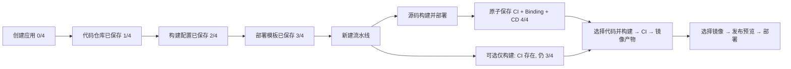
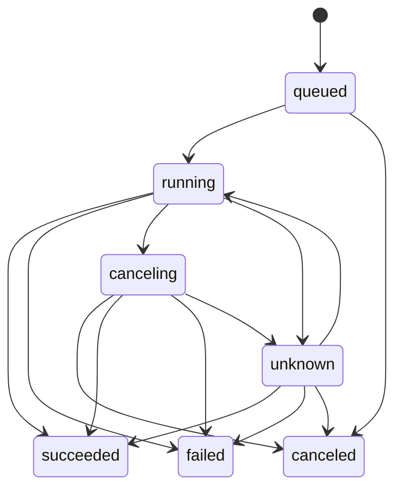
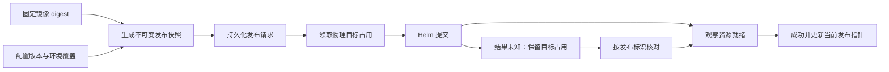

# 业务流程与状态

## 新应用引导与执行资格（V2.1 补充）

完成度由当前配置与流水线推导，不维护可被任意 Save 翻转的 configured 字段。Git 模式四步；镜像模式只计算 Base 与 CD 两步。未保存配置有独立 dirty 状态，Next 不代替 Save；取消新建工作流不能创建任何节点。

Deployment 与 Job 共用发布请求、不可变快照和物理目标占用。Deployment 观察更新副本和就绪；Job 等待 Complete=True，Failed=True 或 activeDeadlineSeconds 到期则失败。Helm SDK 提交成功只表示资源已提交，状态进入 observing。Job 每次发布用新的执行名称（绑定 release + 部署 ID 的受控短后缀）；历史 Job 保留身份供日志和审计定位，不直接更新其不可变 PodTemplate。重试、晋级、回滚会产生新的任务执行，不能声称撤销了任务已有的外部副作用。

Git 提交查询失败发生在构建创建前：不创建 Build、不占用执行槽。查询返回完整 SHA 与 configVersion；触发时重验配置版本并固定 SHA。运行中的克隆失败则产生真正 failed 构建记录，两者不能混在一起。

日志可用性独立于任务状态：runtime、archived、unavailable、expired；不可因为没有归档而把 succeeded 改成 failed。配置进度、执行资格与镜像是否存在也分别展示。

关联：[产品说明](01-product-spec.md)、[接口](../api/01-api-spec.md)、[数据模型](../data/01-data-model.md)。所有状态值以下划线小写存储和传输，页面可以显示中文。

## 1. 构建

| 状态 | 含义与允许动作 |
| --- | --- |
| queued | 已持久化，尚未执行；可取消 |
| running | 已确认关联 Job；可申请取消 |
| canceling | 已请求停止，等待确认；不提前清理工作区或宣称已终止 |
| succeeded | 确认 Job 完成且已验证产物 digest；可部署 |
| failed | 明确失败；可新建重试 attempt |
| canceled | 确认尚未执行或 Job 已终止；可重试 |
| unknown | API 超时或状态无法确认；自动核对，禁止直接重跑 |

`builds` 表达一次固定输入的构建；`build_attempts` 表达执行尝试。`builds.status` 是当前 attempt 的投影，与 attempt 在同一事务内更新。失败/取消后的重试沿用固定提交与配置，attemptNo 加一；变更分支或配置须新建 Build。

先保存 attempt 和确定性 `jobName`，再创建 Job。创建超时后按名称、UID、Podry task 标签查询；同 attempt 不换 Job 名。确认 Job 不存在后才可补建，发现名称冲突但身份不匹配则转人工处理。

Webhook 流程：验证 provider/签名 → 保存唯一 deliveryId → 匹配流水线与分支 → 固定提交 → 创建 Build → 返回 202。重复 Delivery 返回原事件结果。一个 Delivery 可以匹配多个应用，但同一流水线同一 Delivery 只能创建一个 Build。

## 2. 发布

`release_requests.status`：`queued / executing / succeeded / failed / unknown`。

`deployments.status`：`queued / submitting / observing / succeeded / failed / unknown`。

发布请求先包含快照再入队，执行创建 Deployment。`submitting` 确认提交后转 `observing`；就绪条件满足才 `succeeded`。明确的校验或提交失败转 `failed`；超时不等于失败，无法排除已写入时转 `unknown`。核对发现成功则恢复观察或完成，明确没有发生写入才可重试。

首版不提供进行中发布取消：停止观察不能撤销已经写入的资源。发布超时后仍核对实际结果，用户可以在明确终态后发起新发布或回滚。

成功条件：Helm 对应发布已完成；模板中 Deployment 观察到当前 generation，副本就绪；必要 Service/Ingress/配置资源已记录。Ingress 就绪不等于外部流量可达，外部访问测试单列验收。

## 3. 配置与快照

合并次序：内置 Chart 默认值 → 应用基础 Values → 绑定的环境覆盖 → 固定 artifact image digest。后两者不得把平台注入的镜像 digest 改回可变 Tag。

配置保存创建不可变 `app_config_versions`；流水线草稿指向最新配置版本。发布确认携带 `expectedConfigVersion`，服务端生成固定快照，不在后台执行时重新读取最新草稿。版本冲突返回 409。

发布快照包含：应用、绑定和目标身份、artifactId、imageRef、配置版本、合并后 Values 的脱敏版本、Chart 名称/版本/校验值、Secret 版本引用、渲染清单的脱敏版本及校验值。渲染执行所需敏感数据临时解密，不能写入普通日志。

## 4. 多环境晋级

从源环境的成功发布记录选取 artifactId，校验用户对目标绑定的权限，以目标环境配置创建新的快照与发布请求。源环境配置不会覆盖目标环境的域名、副本、资源限制或 Secret。

已有镜像模式通过 Registry 解析并固定 digest，生成 `source=external` 的 Artifact，再进入相同发布流程。首版无须创建虚构 Build。

## 5. 回滚

仅允许选择同一应用、同一绑定的成功历史发布。服务端读取原完整快照，检查 Chart 与 Secret 版本可用性，新建 `kind=rollback` 请求，记录 `rollbackOfDeploymentId`。原 Deployment 历史保持不变。

回滚仍遵守物理目标串行和正常就绪检查。缺失 Secret 历史版本、Chart 包或 digest 不可拉取时明确失败，不降级为只改镜像。跨环境复制镜像叫晋级，不叫回滚。

## 6. 目标占用与 Worker 租约

物理目标键为 `(cluster_id, namespace, release_name)`。`deployment_targets` 保存 activeDeploymentId 和递增 fencingToken；任务租约只控制由哪个 Worker 观察/推进，不代表物理目标可安全重复提交。

领取工作使用短事务和 `FOR UPDATE SKIP LOCKED`。执行外部 I/O 前提交事务，完成后按任务版本和 fencingToken 更新。单实例进程重启或租约到期后，新的 Worker 必须先核对原 Job/Helm release；不得仅因 lease 过期清空 activeDeploymentId。

Helm API 无法原生保证数据库 fencing，因此同一物理目标存在未确认的旧提交调用时，禁止新提交；先确认旧调用退出和远端结果。DB token 只能防止过期 Worker 回写，不能被描述为远端副作用的完整 fencing。

## 7. 资源写入与漂移

编辑读取 `uid + resourceVersion`。Dry Run 返回归一化结果、Diff、对象级校验结果；提交时重新授权、重新校验前置版本，不把预览结果当作永久授权。

首版编辑采用带 resourceVersion 的受控更新；创建使用 Create。暂不默认启用强制 Server-Side Apply 或覆盖其他 fieldManager 的字段。多文档逐个执行，返回 `succeeded / failed / skipped`，失败对象不撤销已成功对象。

Namespace 必须来自明确选择或文档本身并与授权目标一致；不自动创建未授权 Namespace。集群级对象不能夹带 namespace。删除使用 UID 前置条件，默认级联策略由资源类型和确认表单指定。

对平台应用资源的人工修改：写审计 → 重新读取对象 → 标记应用漂移 → 显示 Diff。用户可将可表达的变更保存为新配置草稿；不自动写回生产配置或静默回滚运维修改。

## 8. 日志、终端与资源状态

- 日志为实时或归档字节流，不把网络中断解释为任务失败。
- 终端鉴权与日志权限独立；会话绑定用户、Pod UID、容器、目标与短期票据。
- 应用健康状态 `unknown / progressing / healthy / degraded / stopped` 是由目标资源聚合的只读结果；不与构建状态、部署状态混用。
- 资源身份使用 UID。名称相同但 UID 已变更时，清空旧日志/详情缓存并提示对象已替换。
