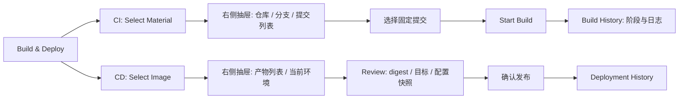

# 页面与交互规格 V2.1

日期：2026-11-19，参考补拍：2026-11-20。依据：[前轮只读观察](../references/devtron-live/README.md)、[新应用完整工作流实测](../references/devtron-onboarding/README.md)、[44 张新应用截图](../references/devtron-onboarding/gallery.html)（首次 26 张、补拍 18 张）。当前入口：[可点击原型](index.html)。V1 保留在 [历史目录](archive-v1/README.md)，不再作为交互基线。

2026-11-20 更新：已按此交互迁入 [Vue 3 + TDesign 工程原型](02-vue-engineering.md)，从 `web/` 运行 `npm run dev:prototype`。本文记录产品交互目标；工程版当前覆盖范围与差异见工程说明，不能把下面所有页面枚举解释为已实现功能。

同日最新修订：Vue 工程版进一步按中文团队使用习惯适配，采用 152px 中文导航、常驻项目/状态筛选、代码构建与环境发布列表；流程关系图放在配置页。菜单统一为应用概览、构建发布、部署状态、构建记录、发布记录、应用配置。新建应用使用居中弹窗，流水线编辑缩小抽屉；技术标识保留原值。以 [本土化说明](04-localization.md) 和 [视觉规范](brand-spec.md) 为准，下文 Devtron 原始路径用于业务对照，旧 HTML 保留历史交互。

本版以用户部署的 Devtron 页面为交互依据，保留英文功能名称用于逐项对照。业务仍按 Podry 已确认的范围：一应用一 CI、多环境 CD、digest、不可变发布快照。真实实例中的两个独立工作流用于理解节点交互，不据此扩大为任意工作流编排引擎。

## 1. 导航层级

```text
152px 中文导航（Vue 工程版；1120px 及以下为 64px 图标栏，720px 以下为 48px）
├─ Application Management
│  ├─ Applications：搜索 / Filter / Create 菜单
│  └─ 应用头部 + 横向功能页签
│     ├─ Overview：About / Environments / Readme
│     ├─ App Details：环境 → 健康状态 → K8s Resources
│     ├─ Build & Deploy：执行画布 → Select Material / Select Image
│     ├─ Build History：流水线选择 + 左侧执行列表 + 右侧过程与内容
│     ├─ Deployment History：环境选择 + 左侧发布列表 + 右侧发布详情
│     └─ Configurations：左侧配置导航 + 右侧编辑区
│        ├─ Git Repository
│        ├─ Build Configuration
│        ├─ Base Configurations → Deployment Template / ConfigMaps / Secrets
│        ├─ Workflow Editor → 点击 CI/CD 节点 → 右侧管线编辑抽屉
│        ├─ External Links（本期展示边界）
│        └─ Environment Overrides → 选择环境 → 继承 / 覆盖
└─ Infrastructure Management / Resource Browser
   ├─ 集群列表
   └─ 集群工作区
      ├─ 页签：Overview / 当前 Kind / Cluster Terminal / 多个资源
      ├─ Kind 列表：左侧分类树，右侧搜索 / Namespace / 表格
      └─ 资源页签：全宽 Manifest / Events / Logs / Terminal
```

构建/部署的**执行**与 Workflow Editor 的**配置**必须分开。资源浏览器的资源详情使用工作区页签，不能再改成右侧详情抽屉。右侧抽屉用于创建应用、选择提交、选择镜像、编辑流水线、创建资源等明确的临时操作。

## 2. 路由合同

下表为原型 Hash 的内部路径；真正 Vue Router 使用 history 模式时复用语义。`appId`、`clusterId` 为 Podry 的 UUID，不直接使用测试实例的数字 ID。Devtron 实例的 `/dashboard` 前缀不成为 Podry 前缀。

| 页面 | 路径 |
| --- | --- |
| 应用列表 | `/application-management/devtron-app/list` |
| 应用概览 | `/application-management/devtron-app/:appId/overview` |
| 环境运行详情 | `/application-management/devtron-app/:appId/details/:environment` |
| 应用内资源详情 | `/application-management/devtron-app/:appId/details/:environment/k8s-resources/:kind/:name/:tab` |
| 构建部署执行画布 | `/application-management/devtron-app/:appId/trigger` |
| 构建详情 | `/application-management/devtron-app/:appId/ci-details/:buildId/:tab` |
| 发布详情 | `/application-management/devtron-app/:appId/cd-details/:deploymentId/:tab` |
| Git / 构建 / 工作流 | `/application-management/devtron-app/:appId/edit/{materials,docker-build-config,workflow}` |
| 基础配置 | `/application-management/devtron-app/:appId/edit/base-config` |
| 环境覆盖 | `/application-management/devtron-app/:appId/edit/env-override/:environment` |
| 集群列表 | `/infrastructure-management/resource-browser/list` |
| 资源列表 | `/infrastructure-management/resource-browser/:clusterId/:kind/:group?namespace=…` |
| 资源详情 | `/infrastructure-management/resource-browser/:clusterId/:namespace/:kind/:group/:name/:tab` |
| 集群概览 / 终端 | `/infrastructure-management/resource-browser/:clusterId/{overview,terminal}` |

原型使用 `?panel=create/material/image/ci/cd/git/create-resource` 表示临时面板，浏览器返回可以恢复原页面。命名空间为集群级对象时使用 `_cluster`。原型简化了 GVR：生产实现必须携带 discovery 返回的 group/version/resource，而不是从 Kind 名称猜复数或 API 版本。

实际实现须将环境、过滤条件、页签写 URL；浏览器刷新可恢复可分享的定位状态。原型当前保留资源详情和 Namespace 的 URL，发布历史环境、基础配置子页等部分状态仍在内存中，不表示完整的路由持久化已经实现。

## 3. 应用列表与创建

参考截图：01、02、03。

1. 主区直接显示列表工具栏和表格，不增加大标题、介绍卡片或统计面板。
2. 表格优先列出 App Name、Environment、Cluster、Namespace、Last Deployed At。未配置应用显示 `Not configured`，名称和齿轮可进入配置。
3. Create 按钮先打开类型菜单，再进入右侧大抽屉。Podry 保留 Custom app / 已有镜像两种交付方式；Chart Store、Job 不在这次范围。
4. 创建抽屉保留列表背景与遮罩，左侧 Create from Scratch / Clone application 和说明，右侧 Project、Application name、Description、可展开 Tags，底部固定 Create Application。
5. Git 模式提交成功进入该应用的 Git Repository 配置；已有镜像模式直接进入 Base Configurations。名称校验失败或同名保留输入。Clone 只复制源配置快照，不复制执行记录、产物、运行资源、CI/CD 节点和目标绑定，需重新确认工作流。

## 4. 配置工作区

参考截图：06、07、08、09、22、23、24。

| 入口 | 布局与行为 | 保存边界 |
| --- | --- | --- |
| Git Repository | 首次表单直接内嵌，选择 Git Account、HTTPS URL；保存后展示仓库卡片；Edit 使用表单抽屉 | Save 成功后才解锁 Next；不自动查询仓库，不混入部署配置 |
| Build Configuration | 容器仓库、Dockerfile、Context、目标平台、构建方式 | Save Configuration 停留；Save & Next 保存后进入 Base |
| Base Configurations | 左侧切换为聚焦导航，返回入口、Deployment Template / ConfigMaps / Secrets | 模板 GUI/YAML 共用草稿；Save Changes |
| Environment Overrides | 同一聚焦布局，展示继承来源和 No override 状态，显式启用覆盖 | 环境覆盖独立版本；发布时合并后冻结 |
| Workflow Editor | 初始为空，New Workflow 先选模板；主模板同时建 Source→CI→CD；编辑按钮打开抽屉 | Create Workflow 原子保存完整定义；Update Pipeline 不触发执行 |

首次配置侧栏显示 0/4 Completed，已保存 Git/Build/Base 后依次变成 1/4、2/4、3/4；完整工作流保存后完成引导。未满足前置条件时显示锁定样式；直接访问未解锁路由也必须显示提示。只创建 CI 不解锁环境覆盖，也不能假造三个默认 CD。镜像模式仅计算 Base、Workflow 两步，不强迫填写 Git。

New Workflow 模板弹窗以 **Build & Deploy from Source Code** 为主项，右侧创建表单同时显示 Git 源、Branch Fixed、Branch Name、Environment、关联 Namespace/Cluster、releaseName 和手动触发选项。环境必须显式选择；Namespace/Cluster 由目标映射且只读。取消与校验失败保留原工作流，不能产生一半的节点。创建成功显示后续选择弹窗：Build & Deploy / Environment Override。

仅构建是独立的可选模板；之后通过 Add Deployment Pipeline 添加 CD。Environment Overrides、应用头部环境数量、App Details 和历史环境选择器均按实际绑定展示，不固定为三环境。未绑定时 App Details 是引导空态，不能出现 checkout-api 的演示资源。

基础模板新增应用 Job 选择；Chart 类型首次保存后禁用修改。hello-world 示例运行后退出，原型引导选 Job；Job 表单仅提供 backoffLimit、activeDeadlineSeconds，固定单次执行，隐藏 Web 服务字段。Save & Next 保存 Base 后进入空 Workflow Editor。CronJob 调度仍为禁用的后续范围，不与 Devtron 的 Create Job 工作流混淆。

管线编辑抽屉顶部有前置/主阶段/后置阶段切换；首版主阶段可编辑，前后置显示范围说明，不假装已实现自定义脚本任务。CI 编辑分支、Dockerfile、Context、仓库；CD 编辑目标、触发方式、滚动发布策略。生产环境只允许手动触发，镜像 digest 为固定约束。

Secret 不在原型中采集或展示明文。GUI/YAML 的正式实现需要合法 YAML 解析、Schema 校验、dirty 状态和并发版本检查；原型仅处理展示的有限字段。

## 5. Build & Deploy

参考截图：05、10、11。保留浅灰工作流画布、带触发方式侧标的节点、最新状态、Details 链接和节点底部动作。



Select Material 默认选中最新样例提交，左侧固定仓库与分支，右侧按提交选择并可搜索，底部固定 Start Build。只有点击 Start Build 才产生构建记录。Git 查询失败显示 Unable to load commits / Retry，空分支与搜索无结果分别提示；没有可用且选中的提交时 Start Build 禁用。Demo 的 offline/empty 场景可分别演示失败和空结果，Retry 仅模拟恢复。

Select Image 的抽屉显示当前目标环境、可选镜像、Latest 与选中态；底部保留 Last saved config / REVIEW / Deploy。首次构建前显示 No Image Available，引导先运行 CI；搜索无匹配与没有产物不是同一状态，不能保留不可见的旧镜像选中值。Review 弹窗与独立确认是 Podry 的补充，本轮也没有点击真实 Deploy。必须固定 digest、配置版本、Namespace、releaseName；Job 额外展示完成条件、执行截止时间和“会新运行任务”的提示；结果未知时保持目标占用。

## 6. 历史页面

参考截图：12、13。

| 页面 | 左侧 | 右侧 |
| --- | --- | --- |
| Build History | Select Pipeline + 按时间的执行条目 | Triggered / Execution / Outcome 时间线，Logs / Source / Artifacts |
| Deployment History | Select Environment + 按时间的发布条目 | 发布目标、操作人、状态，Source / Configuration |

选中项在左侧浅蓝高亮。日志内容在大面积深色区，不再点击表格行后弹一个小日志窗口。历史存储未配置时明确 `Logs not available`；外部镜像没有源代码详情时显示 `Data not available`，不能用模拟成功内容冒充现场证据。

原型保留失败重试、取消、未知结果核对、晋级和回滚的本地模拟。正式实现的回滚取历史快照，晋级只复用镜像并使用目标环境配置。

## 7. Resource Browser

参考截图：14–21。

1. 入口先展示集群表格；进入集群默认到 Nodes。顶部面包屑支持切换集群、Create Resource。
2. 集群工作区顶部保留 Overview、当前 Kind、Cluster Terminal 和多个资源动态页签。列表页签与资源页签同级。
3. 列表左侧是分类树：Nodes / Events / Namespaces、Workloads、Config & Storage、Networking、RBAC、Custom Resource。Jump to Kind 搜索树节点。
4. 列表工具栏包含名称搜索、适用时的 Namespace 筛选、刷新。不同 Kind 使用不同列，例如 Node 的 CPU/Memory、Pod 的 Ready/Status/Restarts/Node。
5. 点击名称打开或激活唯一资源页签，详情占满可用区域，列表树暂时隐藏；点击 Kind 页签返回筛选后的列表。关闭非当前页签不影响当前详情，关闭当前页签回列表。
6. 资源内层页签为 Manifest / Events；Pod 额外有 Logs / Terminal。Manifest 默认只读、深色编辑区，Edit live manifest 才进入编辑。
7. 编辑后 Review changes 展示受控 Diff，确认后更新模拟版本并标记应用漂移。详情中的 Delete、Deployment 的 Scale / Restart 各自显式确认。
8. Logs 提供容器、previous、行数、暂停/恢复、下载；Terminal 在本地只允许演示指令。实际终端连接未在测试实例打开，避免创建远程 shell 会话。
9. Create Resource 打开右侧 YAML 大抽屉，底部 Cancel / Apply。实例提示多文档 YAML；原型只演示单个 ConfigMap，提交前明确提示限制并预览。
10. 切换集群必须清空旧集群资源页签、Namespace 和详情连接。资源身份包含集群、GVR、Namespace、名称及读取后的 UID；不能以名称单独去重。

## 8. App Details 与共享能力

参考截图：04、26、27。应用详情在上方工具条选择环境，下方两个状态区域展示 Application Status、Deployment Status，再进入 K8s Resources、Kind 树和资源列表。Pod 行提供 Logs / Terminal / Events / Manifest 快捷入口。点击后在应用内新增资源页签，保留应用头部、环境、状态区；点击 K8s Resources 返回列表，不跳出应用。

原型和正式实现均在两处复用资源详情内容，用各自工作区承载。All resources 才跳转全局 Resource Browser，并带上物理集群、Kind 和 Namespace。环境切换后只展示该环境的资源页签，不能泄漏上一环境的对象上下文。

## 9. 实现组件合同

| 组件 | 职责 |
| --- | --- |
| GlobalIconRail / ApplicationShell | 全局入口、头部、应用功能页签 |
| AppCreateSheet | 创建/克隆临时表单；成功导航到配置 |
| ApplicationConfigLayout / ConfigurationFocusLayout | 常规配置菜单与基础/环境配置聚焦菜单 |
| WorkflowEditor / BuildDeployCanvas | 分别处理配置动作与执行动作 |
| PipelineEditSheet / MaterialSelectSheet / ImageSelectSheet | 管线编辑、固定提交、固定产物 |
| ExecutionHistoryLayout / ExecutionTimeline | 左记录列表与右详情；任务状态和日志空态 |
| ClusterWorkspaceTabs | 集群内动态页签、激活、关闭、去重和清理 |
| ResourceListWorkspace / ResourceDetailPage | Kind 分类与列表、全宽资源详情 |
| ManifestEditor / LogViewer / PodTerminal | 共享的 YAML、日志、终端能力 |
| DeploymentReviewDialog | 固定 preview token、digest、配置版本和目标，不自行重组发布输入 |

Vue 实现阶段继续使用 `<script setup lang="ts">` 与现有 `web/src/lib/request`。`resourceTabs`、激活项、筛选条件是前端导航状态，不是需要新增数据库表的业务实体。

## 10. 验证边界

本期为文档和独立离线原型；没有接入现有 web 页面、业务 API、Kubernetes、Registry、BuildKit 或 Helm。所有写操作只在内存生效，刷新恢复样例。底部 Demo 面板切换 operator/viewer、正常/空/连接失败、成功/失败/未知结果。

浏览器自动化检查验证结构、路由和可点击流程；现场截图证明观察到的 Devtron 页面，不能证明 Podry 真实功能可用或远程操作成功。详情见 [验证记录](../delivery/02-validation.md)。
